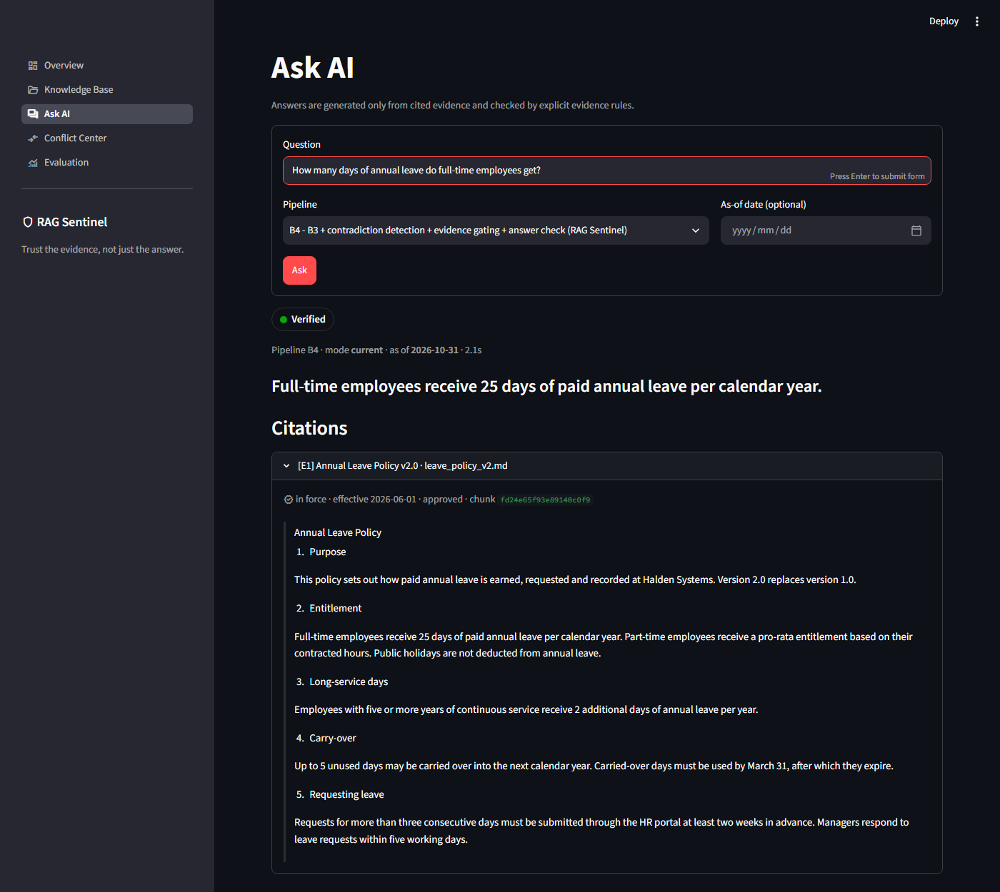
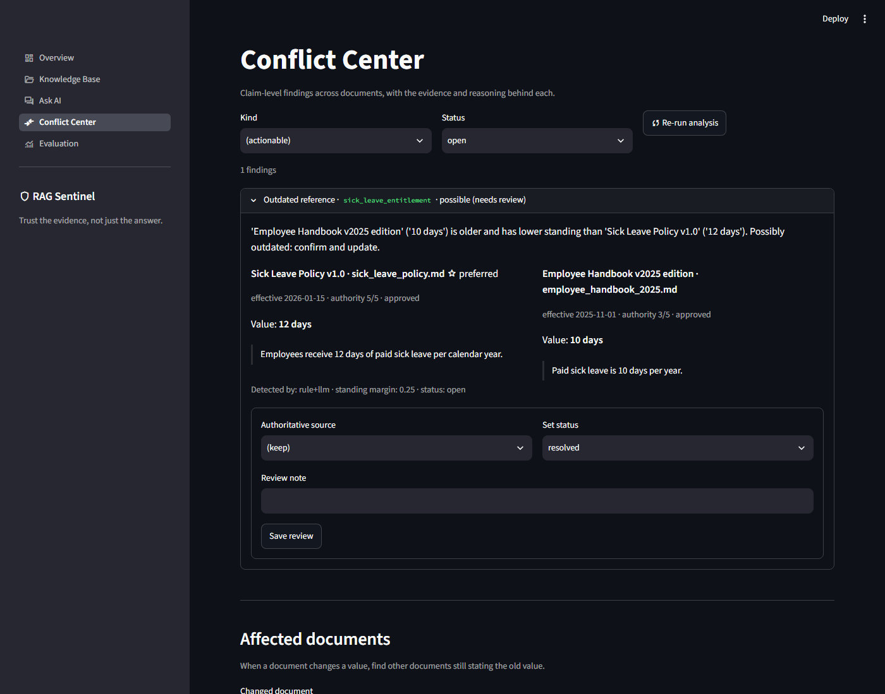
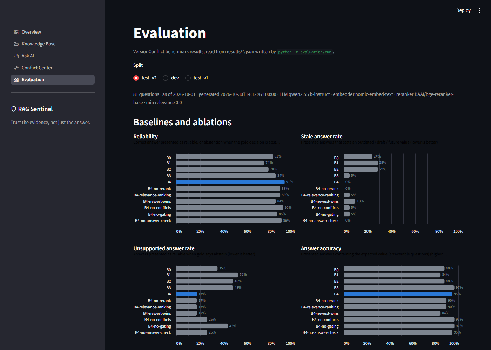
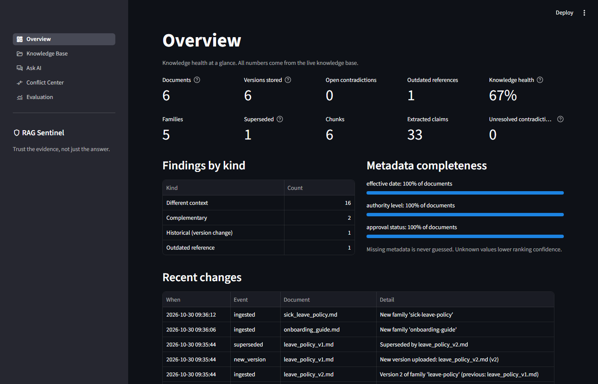

# RAG Sentinel

**A RAG system that knows when its documents disagree, and says so instead of guessing.**



## The problem

When a policy changes, the old version, a wiki page that copied it, and a draft of the next version all stay
in the search index. Ordinary RAG answers confidently from whichever one looks most similar to the question.

## What RAG Sentinel does

* **Tracks versions.** It knows which document is in force, superseded or still a draft, and on what date.
* **Finds conflicts.** It extracts facts from every document and flags contradictions and outdated copies.
* **Ranks by trust.** It prefers sources that are in force, approved and of higher authority.
* **Checks before it answers.** An answer is only marked **VERIFIED** if explicit evidence rules pass.
  Otherwise it returns **NEEDS_REVIEW** (with the conflicting sources) or **INSUFFICIENT_EVIDENCE**.

Everything runs locally and for free: Ollama (`qwen2.5:7b-instruct`, `nomic-embed-text`) and the
`BAAI/bge-reranker-base` reranker.

## Results

Tested on 81 held-out questions that were run once. The benchmark includes stale copies, contradictions and
unanswerable questions.

| | Plain RAG (B0) | RAG Sentinel (B4) |
|---|---|---|
| Reliable answers | 66 / 81 | **74 / 81** |
| Stale answers given | 5 / 21 | **0 / 21** |
| Answered when it should have refused | 8 / 23 | **4 / 23** |

* The gain over plain RAG is +9.9 points, with a 95% confidence interval of +4.6 to +15.7.
* It is not perfect. It still answers 4 questions it should refuse, and it misses 4 of 12 known conflicts.
* Three repeat runs with different random seeds give the same picture (B4 73–74 / 81).

Full method, ablations and failure analysis are in the [evaluation report](docs/evaluation_report.md).

## Screenshots

| Conflict Center | Evaluation |
|---|---|
|  |  |



## Quick start (Windows)

You need Python 3.11, [uv](https://docs.astral.sh/uv/) and [Ollama](https://ollama.com). A GPU with about
6 GB of VRAM is recommended.

```powershell
git clone <this repo> rag; cd rag
uv sync
copy .env.example .env
ollama pull qwen2.5:7b-instruct
ollama pull nomic-embed-text
```

The reranker (about 1.1 GB) downloads on the first run if `SENTINEL_HF_OFFLINE=false` is set in `.env`.

```powershell
.\scripts\run_api.ps1     # API on http://127.0.0.1:8000 (docs at /docs)
.\scripts\run_ui.ps1      # dashboard on http://localhost:8501
```

Then upload the sample HR documents from `benchmark/corpus/dev/hr_leave/` on the Knowledge Base page and ask
*"How many days of annual leave do full-time employees get?"*

## Learn more

* [Architecture](docs/architecture.md): pipeline, verification rules, data model
* [Evaluation report](docs/evaluation_report.md): protocol, results, failures, limitations
* [Developer guide](docs/development.md): CLI, API, running the benchmark, tests
* [Benchmark](benchmark/README.md) · [Changelog](CHANGELOG.md) · [Demo script](docs/demo_script.md)

## Limitations

* Uses one small (7B) model for everything, so it sometimes misses conflicts or accepts an answer that is
  related to the question but doesn't actually answer it.
* The benchmark is small, synthetic, and written by the author. Treat small differences as noise.
* English only. Scanned PDFs are not supported. The Docker setup has not been tested yet.

## License

[MIT](LICENSE)
