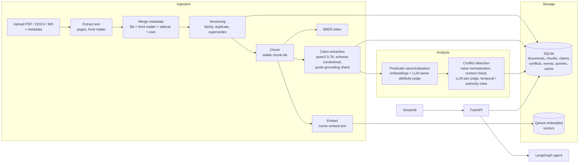
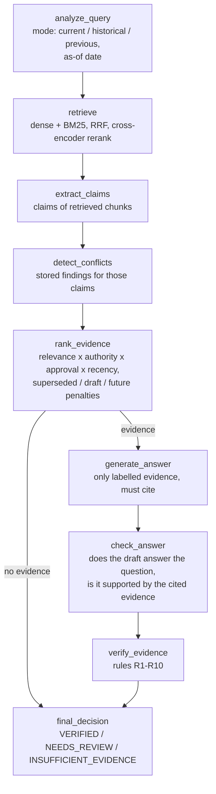

# Architecture

RAG Sentinel is a reliability layer around retrieval-augmented generation. It treats every document as a
**version with metadata** (effective date, approval, authority, supersession) and every answer as a claim
that has to be backed by in-force evidence.

## Components

## Question answering (LangGraph)

Every node writes a trace entry (node, duration, detail), returned with the answer and shown in the UI.

## Verification rules

| Rule | Condition | Decision |
|---|---|---|
| R1 | no evidence, or best reranker relevance below the tuned threshold | INSUFFICIENT_EVIDENCE |
| R2 | no retrieved source is approved and in force at the as-of date | INSUFFICIENT_EVIDENCE |
| R3 | the generator says the evidence does not contain the answer | INSUFFICIENT_EVIDENCE |
| R4 | no valid citation to the provided evidence | INSUFFICIENT_EVIDENCE |
| R5 | the answer states numbers no cited passage contains | NEEDS_REVIEW |
| R6 | every cited source is superseded, draft or not yet effective | NEEDS_REVIEW |
| R7 | an unresolved contradiction exists for a fact the answer relies on | NEEDS_REVIEW |
| R8 | the answer cites an outdated source but not the preferred one | NEEDS_REVIEW |
| R9 | the answer check finds the draft does not provide what the question asks for (two samples must agree) | INSUFFICIENT_EVIDENCE |
| R10 | the answer check finds statements not in the cited evidence, or the check itself failed | NEEDS_REVIEW |

## Conflict kinds

| Kind | Meaning | Actionable |
|---|---|---|
| contradiction | two current sources disagree about the same fact (optionally with a preferred source) | yes |
| outdated | a lower-standing document still states a value that a newer authoritative source changed | yes |
| historical | a version difference within a lineage, or the other source is superseded / withdrawn | no |
| pending_change | a draft or future-dated version would change the value | no |
| different_context | the values apply to different subjects or conditions | no |
| complementary | related but different aspects | no |
| insufficient_evidence | cannot be compared reliably (no semantic judge) | review |

Different values alone never make a contradiction: context, lineage, approval and dates are checked first.

## Design choices

* **No silent fallbacks.** If Ollama or the reranker is unavailable, the operation fails with an explicit
  error. Test doubles exist only in `tests/fakes.py`.
* **Metadata is never guessed.** `suggest_metadata` proposes values for review; unknown fields stay unknown
  and lower ranking confidence.
* **Deterministic first, LLM second.** Values are normalized and compared by rules (money, percent, dates,
  quantities with units, named versions such as "TLS 1.2"). The LLM is used only where rules cannot decide:
  whether two attribute names mean the same thing, and whether two claims share context.
* **Everything is cached by content.** Claim extraction and judge calls are keyed by text hash, model and
  prompt version, so re-analysis is cheap and reproducible.
* **Embedded Qdrant** keeps the deployment to one process, and only one process may open a data folder
  at a time.
